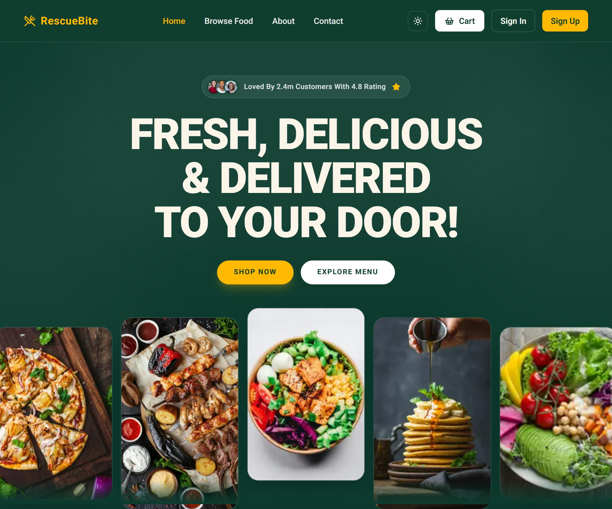

# RescueBite



RescueBite is a food-rescue marketplace that connects food providers with nearby customers so surplus food can be claimed before it goes to waste.

The platform helps restaurants, bakeries, grocery stores, and similar providers list surplus items, while recipients can browse, reserve, and collect food directly from the source.

This repository contains both the backend API and the Next.js frontend client:

- `RescueBite/` — Express + TypeScript backend
- `rescuebite_frontend/` — Next.js frontend for browsing, auth, profile, reservation, and dashboard flows

## Why RescueBite?

Food waste is a practical everyday problem. RescueBite turns surplus inventory into a simple marketplace:

- Providers can post available food with quantity, pickup timing, and location details.
- Receivers can search and reserve food that matches their needs.
- Dashboards support role-based access for providers, customers, and admins.
- The flow supports real-world pickup logistics, payments, and image uploads.

## Features

- Role-based authentication and authorization for admin, provider, and receiver roles
- Provider profile creation and dashboard management
- Food listing creation, editing, status updates, and deletion
- Reservation flow for users to reserve and cancel food pickups
- Payment integration with SSLCommerz
- Email verification, password reset, and Google login
- Cloudinary-based image uploads
- PostgreSQL-backed data persistence
- Redis integration for background utility support
- Responsive web UI built with Next.js and Tailwind CSS

## Tech Stack

### Frontend

- Next.js 16
- React 19
- TypeScript
- Tailwind CSS
- shadcn-style UI components
- `ofetch` for API requests

### Backend

- Node.js
- Express
- TypeScript
- Prisma ORM
- PostgreSQL
- Redis
- JWT-based auth
- Zod validation
- Nodemailer for email flows
- Cloudinary for media uploads

## Project Structure

```bash
RescueBite/
├── src/
│   ├── app.ts
│   ├── server.ts
│   ├── config/
│   ├── lib/
│   ├── middlewares/
│   ├── modules/
│   ├── templates/
│   ├── types/
│   └── utils/
├── prisma/
├── package.json
├── tsconfig.json
├── .env
└── ...

rescuebite_frontend/
├── src/
│   ├── app/
│   ├── components/
│   ├── lib/
│   └── ...
├── package.json
├── next.config.ts
├── .env.local
├── tsconfig.json
└── ...
```

## Backend API Overview

The backend exposes the main API groups below:

- `/api/v1/auth` — login, registration, email verification, Google auth, password reset
- `/api/v1/provider` — provider profile creation and provider-specific logic
- `/api/v1/food-listing` and `/api/v1/food-listings` — listing CRUD and status management
- `/api/v1/reservation` and `/api/v1/reservations` — reservation creation, lookup, and cancellation
- `/api/v1/admin` — admin dashboard and provider management operations
- `/api/v1/payments` — payment flow and transaction handling
- `/api/v1/upload` — media upload endpoints
- `/api/v1/users` — user profile management
- `/health` — health check endpoint used for deployment readiness checks

## Getting Started

### Prerequisites

- Node.js 18+ recommended
- npm
- PostgreSQL instance
- Redis instance
- Cloudinary account
- Google OAuth credentials
- Email credentials for SMTP

### 1) Install backend dependencies

```bash
cd RescueBite
npm install
```

### 2) Configure environment variables

Create a `.env` file in `RescueBite/` with values like:

```env
PORT=5000
DATABASE_URL="postgresql://you need to put your's"

JWT_ACCESS_SECRET=your_access_secret
JWT_REFRESH_SECRET=your_refresh_secret
JWT_ACCESS_EXPIRES_IN=1d
JWT_REFRESH_EXPIRES_IN=7d

REDIS_USERNAME=
REDIS_PASSWORD=
REDIS_HOST=localhost
REDIS_PORT=

SMTP_USER=
SMTP_PASSWORD=
EMAIL_SENDER=

SSL_COMMERZ_STORE_ID=your_store_id
SSL_COMMERZ_STORE_PASSWORD=your_store_password
SSLCOMMERZ_INIT_URL=
SSLCOMMERZ_VALIDATION_URL=
SSLCOMMERZ_SUCCESS_URL=
SSLCOMMERZ_FAIL_URL=
SSLCOMMERZ_CANCEL_URL=
SSLCOMMERZ_IPN_URL=

CLOUDE_NAME=
CLOUDINARY_API_KEY=
CLOUDINARY_API_SECRET=

GOOGLE_CLIENT_ID=
GOOGLE_CLIENT_SECRET=
```

### 3) Prepare the database

```bash
cd RescueBite
npx prisma generate
npx prisma migrate dev
```

If you are using a pre-existing schema or want a quick sync in development, `prisma db push` is also an option depending on your workflow.

### 4) Start the backend

```bash
cd RescueBite
npm run dev
```

The API will run on:

- http://localhost:5000
- Health check: http://localhost:5000/health

### 5) Install and run the frontend

```bash
cd rescuebite_frontend
npm install
```

Create a `.env.local` file in `rescuebite_frontend/`:

```env
NEXT_PUBLIC_GOOGLE_CLIENT_ID=
NEXT_PUBLIC_BACKEND_URL=http://localhost:5000/api/v1
```

Then start the frontend:

```bash
cd rescuebite_frontend
npm run dev
```

Open the app at:

- http://localhost:3000

## Scripts

### Backend (`RescueBite/`)

```bash
npm run dev      # run development server with tsx watch
npm run build    # build production bundle
npm run start    # run production server
npm run format:check
npm run format:fix
```

### Frontend (`rescuebite_frontend/`)

```bash
npm run dev      # run Next.js dev server
npm run build    # create production build
npm run start    # serve production build
npm run lint     # run Biome checks
npm run format   # format code with Biome
```

## Typical User Roles and Flows

### Provider flow

- Sign up / log in as a provider
- Create a provider profile
- Add food listings with images and pickup details
- Update listing status as food is claimed or removed
- Track pickups and manage availability

### Receiver flow

- Create an account
- Browse food listings by category and location
- Reserve food items
- View personal reservations
- Cancel reservations when needed

### Admin flow

- Review user and provider activity
- Manage provider-related records from the admin dashboard
- Monitor platform operations and overrides

## Production Notes

- Use strong JWT secrets and environment protections in production.
- Keep database credentials and third-party keys out of source control.
- Configure CORS and deployment URLs correctly for production environments.
- Use production-grade PostgreSQL and Redis services instead of local instances for live deployment.
- Validate payment callback URLs and provide secure HTTPS endpoints.

## License

This project is configured with the ISC license in the backend package metadata.

## Contributing

Contributions are welcome. For feature work or bug fixes:

1. Create a branch from the current project state.
2. Implement the change with a focused scope.
3. Validate the affected frontend or backend flows.
4. Open a pull request with a clear summary of the update.

## Support

For questions about setup, deployment, or feature flows, refer to the repository issues or contact the project maintainer.
